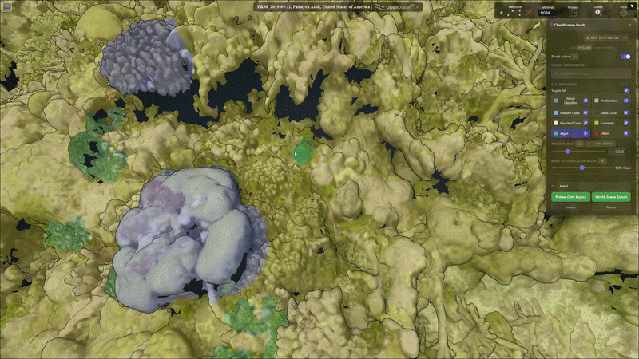

# OpenHeritage3D-VIS

*A browser-based Potree viewer template for cultural heritage point clouds — with a classification brush, zone-based navigation, tiled downloads, and other features [Potree](https://github.com/potree/potree).*

[](LICENSE)
[](https://github.com/potree/potree)

<!--  -->

This repository is developed by the [Cultural Heritage Engineering Initiative (CHEI)](https://alertcalifornia.org) at UC San Diego and is published alongside an academic paper describing its classification workflow. See [Citing this work](#citing-this-work).

---

## Table of Contents

1. [What this is](#what-this-is)
2. [Feature overview](#feature-overview)
3. [⭐ Classification Brush](#-classification-brush)
4. [Zone-Based Navigation](#zone-based-navigation)
5. [Layer Map — alternate datasets per zone](#layer-map--alternate-datasets-per-zone)
6. [Point Cloud Download Tool](#point-cloud-download-tool)
7. [Oriented Images / 360° Panorama Mode](#oriented-images--360-panorama-mode)
8. [Transform Controls & Tools Menu](#transform-controls--tools-menu)
9. [Shareable Camera Links](#shareable-camera-links)
10. [Floating Panel System](#floating-panel-system)
11. [Keyboard Shortcuts](#keyboard-shortcuts)
12. [Gamepad Controls](#gamepad-controls)
13. [Getting Started](#getting-started)
14. [Supported Point Cloud Formats](#supported-point-cloud-formats)
15. [Classification Ledger → LAS Patch Script](#classification-ledger--las-patch-script)
16. [Architecture Notes](#architecture-notes)
17. [Repository Layout](#repository-layout)
18. [Citing This Work](#citing-this-work)
19. [License](#license)

---

## What this is

[Potree](https://github.com/potree/potree) is an open-source WebGL point cloud renderer built for out-of-core streaming of massive octree-organized datasets. This repository is a **template built on top of a patched Potree core** (see [Architecture Notes](#architecture-notes)), adding a set of tools written for cultural heritage documentation workflows — annotating, navigating, and distributing terrestrial/aerial LiDAR and photogrammetry scans of heritage sites.

Everything here is static, client-side JavaScript. There is no backend, no database, no accounts — a viewer instance is just this repository served over HTTP, pointed at one or more point clouds.

## Feature overview

| Feature | Summary |
|---|---|
| [Classification Brush](#-classification-brush) | Paint LAS/LAZ classification codes directly onto the point cloud in-browser, with an edit ledger that can be exported and applied back to the source files. |
| [Zones](#zone-based-navigation) | Camera-collision-triggered regions that show/hide point clouds and annotations as you move through a site. |
| [Layer Map](#layer-map--alternate-datasets-per-zone) | Toggle between alternate scans/datasets (e.g. different capture dates or sensors) covering the same physical space. |
| [Download Tool](#point-cloud-download-tool) | Export any clipped selection as tiled LAS files, entirely in-browser, with a level-of-detail cap. |
| [Oriented Images](#oriented-images--360-panorama-mode) | Lock the camera to a photo's captured pose and cross-fade it against the point cloud. |
| [360° Panoramas](#oriented-images--360-panorama-mode) | Spherical panorama markers rendered with photo-sphere-viewer, sharing the oriented images' controls and keybinds. |
| [Transform Controls](#transform-controls--tools-menu) | Move/rotate/scale a loaded point cloud with an on-screen gizmo or typed values (registration / alignment). |
| [Shareable Links](#shareable-camera-links) | Camera pose and zone/visibility state round-trip through the URL. |
| [Shortcut Guide](#keyboard-shortcuts) | An illustrated keyboard/mouse overlay covering every binding in the viewer. |
| [Gamepad Controls](#gamepad-controls) | Fly the viewer with a game controller: orbit and fly schemes that follow Potree's navigation mode, a crosshair that opens photos, 360° views and zones and aims the measuring tools and Point Inspector, the toolbar and its panels from the D-pad, a quick wheel of common tools, and a guide with a live controller diagram. |
| [COPC Streaming](#supported-point-cloud-formats) | Load a `.copc.laz` file directly over HTTP range requests — no PotreeConverter step — with full brush and export support. |

---

## ⭐ Classification Brush



The classification brush is the centerpiece of this template and the subject of the paper this repository accompanies. It lets a user reclassify LAS/LAZ points (ground, building, vegetation, noise, custom site-specific classes, …) by painting directly on the rendered point cloud, without ever downloading the source data — classification happens against Potree's already-streamed octree nodes in the browser.

**How edits are tracked.** Every edit is recorded in an in-memory *ledger*, keyed by point cloud and octree node, using one of three entry shapes:

- **Implicit** — an entire node is marked with a single classification (used when a brush stroke fully covers a node's bounding box; the node doesn't need to be loaded to be marked).
- **Per-point override** — an explicit map of individual point indices to classifications (used at stroke boundaries, where only part of a node is affected).
- **Hybrid** — an implicit baseline classification for the node, plus per-point overrides on top of it.

Potree's node-naming convention (child node names are prefixes of their parent, e.g. `r0` → `r03` → `r031`) lets a coarse implicit mark at one level of the octree apply as the baseline for every node loaded beneath it later, without re-walking the tree.

**Traversal strategy.** A brush stroke's bounding volume is matched against the octree in three tiers, so that reclassifying a large region never requires loading it:

1. **Prune** — nodes whose bounding box doesn't intersect the stroke are skipped entirely.
2. **Full containment** — nodes fully inside the stroke are marked implicitly, with no node load required.
3. **Boundary** — nodes that only partially overlap the stroke are loaded and inspected per-point.

Reconciliation with newly streamed-in geometry is event-driven, hooked into Potree's own node-load completion callback, so edits apply the instant a node finishes loading rather than on a polling timer. The same hook is fired by the COPC loader, so the brush behaves identically on either format.

**Painting.** `Z` toggles the brush; `Ctrl`/`Cmd` + drag paints, `Ctrl`/`Cmd` + click paints a single spot. `Q` / `E` (or `Ctrl` + scroll, mid-stroke) resize the brush, `W` cycles the RGB / classification color blend so you can see what you've painted against the original colors, and `1`–`9` switch the paint classification without leaving the canvas. The palette defaults to the standard ASPRS codes (ground, the three vegetation heights, building, water, low/high noise, …); a deployment can substitute its own class list, which then travels with the export. The grid scrolls and ellipsizes long labels rather than overflowing the panel.

**Safety and cleanup features:**

- A per-class visibility gate prevents a bulk edit from silently overwriting points in a classification the user has currently hidden.
- A post-stroke promotion pass compacts per-point overrides back into implicit node-level marks where a stroke ends up covering a full node, keeping the ledger small.
- Large clip volumes can be split into an *N×N* grid of sub-tiles (A1, A2, B1, …) for distributing classification work across multiple contributors or sessions.

**Import / export.** The ledger exports in two gzipped formats, chosen by what you intend to do with it:

- **Potree-Only Export** (`*_ledger.gz`) — a compact binary dump of the ledger for continuing work in another session, or merging edits from multiple contributors. Node baselines are one byte each and per-point overrides are run-length encoded, so a multi-million-override ledger stays a couple of megabytes. It carries no world coordinates and is re-importable into the viewer only.
- **World-Space Export** (`*.csv.gz`) — AABBs for implicit regions (with the octree depth that decides which of two overlapping boxes wins) plus world-space `(x, y, z)` coordinates for every explicit override. This is the format consumed by the [classification ledger → LAS patch script](#classification-ledger--las-patch-script) to apply edits back to the original LAS/LAZ files.

**Import** accepts `.gz` and `.csv` (including ledgers written by earlier, uncompressed versions of both exports) and takes several files at once, merging them into the current ledger. A viewer instance can also auto-load a ledger at startup from a URL.

**Measuring ledger cost.** `libs/custom/classification_entropy.js` reproduces the compressibility figures quoted against the ledger in the paper. From the browser console:

```js
await measureClassificationCompressibility();     // pass { applyLedger: false } for the unedited baseline
```

It walks the whole octree in order, streams each node's classification attribute through a gzip `CompressionStream`, and disposes the node before moving on — so a 456M-point cloud is measured without ever holding 9 GB of geometry resident. It reports raw size, order-0 entropy, gzipped size, bits per point, run counts, and a per-class breakdown.

<!--  -->
<!--  -->

---

## Zone-Based Navigation

<!--  -->

A **zone** bundles a name, one or more trigger bounding boxes, a list of point clouds to show/hide, and optional annotations for points of interest inside it (e.g. individual artifacts or architectural features within a room). Zones activate automatically as the camera crosses their trigger volume, so moving through a multi-scan site swaps in the relevant point clouds without a manual toggle.

A read-only zone/annotation browser tree lets users search by name and jump straight to a location — selecting a result flies the camera there and the corresponding zone activates on arrival. The tree refreshes itself when an oriented-image set finishes loading, so image sets that resolve after the panel was built still show up.

<!--  -->

Zones are visualized with animated, glowing beacon markers (pulsing wireframe icosahedra) so points of interest are visible from a distance before the camera triggers the zone itself.

<!--  -->

<!-- ## Layer Map — alternate datasets per zone -->

<!--  -->

<!-- Within a zone, the Layer Map panel lets a user define selectable sub-regions and toggle between alternate point cloud layers covering the same physical space — for example switching between scans from different capture dates, sensors, or processing passes without leaving the viewer.

Marker hover testing is occlusion-aware: a marker behind a wall no longer answers the cursor. Ordinary raycasting can't see the point cloud (Potree picks it on the GPU) or the oriented images (which render in a post-composite overlay), so hits are re-tested against a tight point pick along the same ray. -->

## Point Cloud Download Tool

<!--  -->

Clip a region of the scene with Potree's native selection tools, then export it as one or more LAS files — entirely client-side, no server round-trip. Large selections are automatically split into a grid of tiles sized to stay within a practical per-file point budget, with tile counts on each axis chosen to preserve the selection's aspect ratio. Classification edits in the ledger are baked into the exported points, including nodes that only inherit a baseline class from a coarser ancestor.

A Level-of-Detail slider caps how deep the export walks the octree, trading point density for file size and export time. COPC clouds reveal deeper octree levels as pages stream in *during* an export, so the cap is derived from the deepest level actually loaded rather than the hierarchy known up front — an export never discards its own finest points, while a lower LOD setting is still honored.

When available, the File System Access API is used so every tile lands directly in one user-chosen folder; browsers without that API fall back to staggered individual downloads. Each export is accompanied by a JSON manifest recording what was selected, tiling parameters, and provenance metadata.

## Oriented Images / 360° Panorama Mode

<!--  -->

Both photo types — flat oriented images and spherical panoramas — are placed as markers in the scene and share one interaction model: hover for a card naming the photo, its set, and the gesture that opens it; double-click to step inside it. Entering a photo hides every other marker in the scene (across all zones and both image types) so nothing floats in front of the picture, and leaving restores exactly what was visible before rather than switching everything back on.

<!--  -->

**Oriented images.** Opening one locks the camera to that photo's captured pose and opens a panel with:

- An opacity slider that cross-fades the photograph against the point cloud behind it (composited as a post-process overlay, so lowering opacity reveals the actual geometry rather than a background color).
- Previous/next navigation through the image set without leaving image mode.
- Download of the original full-resolution photo.
- Full keyboard control — arrow keys to navigate, `Space` to momentarily peek behind the photo, `[`/`]` to nudge opacity, `W` to cycle preset opacity levels, `Esc` to exit.

Image sets can carry **per-image camera calibrations**: the bundled `OrientedImageLoader` accepts multiple `<calibration>` blocks and matches them to image rows by position or id, falling back to the classic single-calibration `camera.xml` when there's only one. This matters for sets assembled from more than one camera body or lens.

<!--  -->

**360° panoramas.** Spherical panoramas open in a [photo-sphere-viewer](https://photo-sphere-viewer.js.org/) panel, restyled into the same floating glass pill the oriented-image panel uses, with the same opacity slider and the same `←`/`→`, `[`/`]`, `W`, `Space` and `Esc` bindings — so moving between the two photo types doesn't mean learning a second set of controls. Tiled panoramas are supported for high-resolution spheres, along with gyroscope and fullscreen modes.

<!--  -->

## Transform Controls & Tools Menu

<!--  -->

A panel for placing a loaded point cloud in space — useful for manually aligning a newly registered scan against existing data. It offers two ways to work:

- **The gizmo** — drag to move, rotate, or scale, with `T` / `R` / `S` (or the Move / Rotate / Scale buttons) switching mode. `D`, or the Couple Proxy toggle, detaches the cloud from the gizmo's proxy so you can reposition the handle itself without moving the data; a pill in the panel header always shows which state you're in.
- **Typed values** — nine numeric fields for position, rotation, and scale, committed on Enter or blur. These are absolute values in the cloud's own frame, so unlike a gizmo drag they pivot on the cloud's origin. Live Δ readouts under each field show how far the cloud has moved from where it loaded.

**Move PC** applies the proxy's transform to the cloud, **Reset** returns it to its loaded position, and **Export** emits copy-pasteable `pointcloud.translateX(...)` / `rotateX(...)` / `scale` code, so an alignment worked out interactively can be baked into the loader call in your own HTML.

A "Tools" menu in the toolbar gathers quick actions that don't warrant a permanent toolbar button of their own — zone creation, volume download, and point cloud transform, among others.

<!--  -->

## Shareable Camera Links

Camera position/target, active zone, and point-cloud visibility state round-trip through URL query parameters. Moving the camera updates the URL (debounced), so copying the current address reproduces the same view — including which zone and point clouds are active — for anyone who opens it.

<!--  -->

## Floating Panel System

All of the side panels above (zones, download, layer map, transform, oriented images, tools) share a lightweight window-manager layer: every panel is draggable by its titlebar, resizable from eight edge/corner handles, and auto-placed so opening a new panel stacks it down the right edge and wraps into a new column rather than burying whatever's already open.

## Keyboard Shortcuts

<!--  -->

The `?` button on the classification panel opens an illustrated shortcut guide — a keyboard and mouse diagram whose keys light up as you read down the legend, grouped by brush, painting, photo, and camera bindings. All shortcuts pause while you're typing in a text field.

| | |
|---|---|
| `Z` | Toggle the brush on / off |
| `Q` / `E` | Shrink / grow the brush radius |
| `Ctrl` + scroll | Resize the brush mid-stroke |
| `W` | Cycle RGB / classification blend (in photo view: cycle photo opacity) |
| `1`–`9` | Switch the paint classification |
| `Ctrl` + drag / click | Paint the selected class |
| `Shift` (hold) | Name the nearest photo to the cursor |
| `Shift` + click | Jump into that photo's view |
| `←` / `→` | Previous / next photo |
| `Space` (hold) | Peek at the point cloud behind the photo |
| `[` / `]` | Nudge photo opacity down / up |
| `Esc` | Leave photo view |
| `T` / `R` / `S` | Transform gizmo: move / rotate / scale |
| `D` | Couple / decouple the transform proxy |

The toolbar works from the keyboard too. `Tab` reaches its buttons and the rows of the Zones panel, and `Enter` or `Space` presses them. In the Tools menu the arrow keys move between tools. `Esc` closes the Zones panel or the Tools menu and returns to the toolbar.

## Gamepad Controls

Any controller the browser reports with the standard layout (Xbox, PlayStation, Switch Pro and most modern pads) can fly the viewer. Connect it and press one of its buttons; browsers only reveal a controller after that. The controller follows Potree's navigation mode instead of adding its own: Orbit and Earth get an orbit scheme, Fly and Helicopter a free-flight one, and `X` switches between the two. In both, the left stick moves and the right stick turns the view, and the mouse and keyboard keep working alongside.

**Moving**

| | Orbit / Earth | Fly / Helicopter |
|---|---|---|
| Left stick | Pan over the ground | Fly forward / sideways |
| Right stick | Orbit the center | Look around |
| `LT` / `RT` | Zoom out / in | Down / up |
| `LB` / `RB` | Down / up | Slower / faster (Potree's move speed) |

**Actions** (both modes)

| | |
|---|---|
| `A` | Go to the spot under the crosshair, which becomes the orbit center, or open the photo, 360° view or zone beacon there |
| `B` | Back: leave a photo, then return to the view before the last jump |
| `Y` | Overview of every visible cloud |
| `X` | Switch between Orbit and Fly |
| D-pad `◀` `▶` / `▲` `▼` | Turn 90° / tilt 45° |
| `Menu` | Go to the toolbar and panels (below) |
| `View` | Tap: open the gamepad guide. Hold: the quick wheel (below) |

Inside a photo or a 360° view, `◀` / `▶` step through the set, `▲` / `▼` make the photo more or less opaque in 10% steps, `Y` cycles its opacity through 100%, 50% and 0%, and `B` leaves. In a 360° view, either stick looks around and the triggers zoom.

**Toolbar and panels.** `Menu` puts a highlight on the toolbar's Zones button. The D-pad moves it to the nearest button in that direction, whichever panel it is in, and scrolls long lists such as the zone tree. `A` presses the highlighted button. When that opens a panel or menu, such as Zones or Tools, the highlight moves into it, landing on the first zone in the Zones panel. On a list or slider (the material picker, an opacity slider), `A` starts a change: the D-pad changes the value and `A` again finishes. `B` closes the panel the highlight is in and returns to the button that opened it; on the toolbar, `B` or `Menu` goes back to moving the view. The sticks keep moving the camera meanwhile. Opening a photo or 360° view, starting a measurement or the Point Inspector, or using the mouse, leaves the toolbar too.

**Measuring and the Point Inspector.** The toolbar's measuring tools aim with the crosshair. While a distance or height is being drawn, its newest marker sits under the crosshair, `A` adds a point there and `B` finishes; `B` before the first point cancels the measurement. A height takes two presses of `A`. With the Point Inspector open, it reads the point under the crosshair and follows it as the view moves.

**Quick wheel.** Hold `View` and the toolbar's most used tools come up in a ring: Zones, Point Inspector, Measure distance, Measure height, Clear measurements, Next material, Images on/off, and Hide crosshair (for screen recordings). Point at one with either stick and let go of `View` to use it, or press `B` to close the wheel without choosing. Tools that don't apply at that moment are dimmed, such as measuring inside a 360° view. Zones opens the Zones panel with the highlight on a zone, as if reached from the toolbar.

The crosshair marks the orbit center. When it rests on a photo, 360° marker or zone beacon, a prompt names what `A` will open. `View` (or Tools ▸ Gamepad Controls) opens a guide with a live controller diagram, which also shows whether the browser recognised the controller. The guide lists the mapping for both modes, with the current mode highlighted, and holds the settings: invert look, look speed, swap sticks (move with the right stick) and vibration, saved in the browser. Button names follow the controller, e.g. `✕ ○ □ △` and `L1`/`R1` on PlayStation.

When the viewer is embedded in a page on another domain, Chrome allows controller input by default, but Firefox only allows it in same-origin frames, so add `allow="gamepad"` to the `<iframe>`.

---

## Getting Started

This repository ships two HTML entry points:

- **`index.html`** — the entry point used for archived deployments, which loads its dataset, title, and licensing terms from external metadata rather than being edited directly.
- **`standalone.html`** — a barebones entry point for pointing this template at your own data. Start here.

To run a viewer locally:

```bash
git clone https://github.com/CHEI-OpenHeritage3D/OpenHeritage3D-VIS.git
cd OpenHeritage3D-VIS
python3 -m http.server 8080
# open http://localhost:8080/standalone.html
```

Open `standalone.html` and edit the `Potree.loadPointCloud(...)` call in the **POINT CLOUDS** block near the bottom of the script to point at your own dataset:

```js
Potree.loadPointCloud("https://your-host/path/to/metadata.json", "my point cloud", e => {
    let pointcloud = e.pointcloud;
    viewer.scene.addPointCloud(pointcloud);
    viewer.scene.view.position.set(0, 0, 0);
    viewer.scene.view.lookAt(new THREE.Vector3(0, 0, 0));
});
```

Call it once per cloud; clouds can be layered freely (e.g. an aerial scan plus a photogrammetric model of the same site), and the classification panel can target one of them or all at once. Any of the [supported formats](#supported-point-cloud-formats) can be passed here — but note that hosting the *data* takes a `Range`-capable server, which `python3 -m http.server` is not; see [the note below](#a-note-on-serving-point-cloud-data).

`standalone.html` loads the same custom tooling as `index.html` (zones, classification brush, download tool, oriented images, transform controls, etc.) with no external metadata dependency, no license gate, and no zone/classification-ledger auto-loading — it's a clean starting point for a new deployment. See the comment block at the top of the file for the full list of what was intentionally left out.

## Supported Point Cloud Formats

`Potree.loadPointCloud()` dispatches on the URL you hand it:

| Format | URL to pass | Notes |
|---|---|---|
| **Potree 2.0 octree** | `.../metadata.json` | The default. Convert LAS/LAZ with PotreeConverter 2.x: `PotreeConverter input.laz -o output_dir` |
| **COPC** | `.../cloud.copc.laz` | A single [Cloud Optimized Point Cloud](https://copc.io/) file — no conversion step at all |
| **Potree 1.x octree** | `.../cloud.js` | Legacy datasets |
| **Entwine (EPT)** | `.../ept.json` | |

**On COPC.** The bundled Potree build carries a COPC loader (ported from Potree 1.8.2), which streams the octree straight out of one `.copc.laz` file using HTTP range requests, decoding LAZ chunks in a worker via laz-perf WASM. Serving a COPC file therefore requires a static server that honors `Range` requests (see [a note on serving data](#a-note-on-serving-point-cloud-data)). The classification brush, the tiled LAS export, and the ledger formats all work on COPC clouds.

One caveat: ledgers are keyed by octree node name, and a COPC file's octree is not the same tree PotreeConverter builds. A ledger exported from a COPC cloud is not interchangeable with one exported from a converted Potree 2.0 octree of the same data — pick one representation per classification campaign. (The World-Space Export is unaffected: it carries no node names, only world coordinates.)

### A note on serving point cloud data

`python3 -m http.server` is fine for serving *the viewer*, but it ignores HTTP `Range` headers — and both Potree 2.0 (which fetches byte ranges out of `octree.bin`) and COPC (which fetches them out of the `.copc.laz` file) depend on them. Point the viewer at data hosted somewhere that honors ranges: nginx, Apache, Caddy, S3/CloudFront, or any small Range-aware script of your own. The dataset in `standalone.html` is remote for exactly this reason.

## Classification Ledger → LAS Patch Script

The classification brush's edits live only in the browser until they're applied back to the source LAS/LAZ files. [`tools/classification_injector/`](tools/classification_injector/) contains a standalone Python script that does exactly that, using the brush tool's **World-Space Export**:

```bash
cd tools/classification_injector
pip install -r requirements.txt
python classification_injector.py ./las_tiles classification_edits.csv.gz
```

It applies implicit regions (AABBs) in order of octree depth, then per-point overrides on top — overrides take precedence, mirroring the ledger semantics in the viewer itself. Overrides are matched to LAS points by nearest-neighbor lookup within a configurable tolerance (KD-tree accelerated), since floating-point round-tripping through the browser can introduce sub-millimeter drift. `<las_path>` and `<edits>` both accept either a single file or a folder, and both the gzipped and plain-text forms of the export are read (as is the older `#FORMAT,python` CSV, for ledgers exported before the rename). Multiple edit files are merged before being applied. See [`tools/classification_injector/README.md`](tools/classification_injector/README.md) for the full option reference, including `--dry-run` to preview match counts before writing anything.

The Potree-Only Export is *not* an input to this script — it carries no world coordinates. Pointing the script at one produces a warning and no edits.

## Architecture Notes

- **Client-side only.** No backend, no accounts, no server-side state — a deployment is this repository plus one or more point clouds served as static files.
- **Patched Potree core.** The bundled `build/potree/potree.js` includes several modifications the custom tooling above depends on: an event fired on node-load completion (used by the classification brush to reconcile edits against newly streamed geometry), oriented-image mode and hover events, per-image camera calibrations in the oriented-image loader, a COPC loader and its LAZ decoder worker, and picking/geometry accessors used for point-accurate selection.
- **Upstream tracking.** Changes from upstream Potree 1.8.2 are merged into the bundle — including DXF profile export and additional UI translations (Catalan, Italian, Chinese) — rather than the repository pinning an older Potree indefinitely.
- **No installed dependencies for the viewer itself.** Everything under `libs/` and `build/` (including the patched Potree build and the laz-perf WASM decoder) is vendored; opening the HTML over any static file server is sufficient.

## Repository Layout

```
index.html              Archive-integrated entry point
standalone.html         Barebones entry point — start here for a new deployment
build/potree/           Patched Potree 2.0 build (BSD-2-Clause, see LICENSE)
build/potree/workers/   Decoder workers, including COPC/LAZ + laz-perf WASM
libs/                   Vendored third-party libraries (three.js, copc, photo-sphere-viewer, ...)
libs/custom/            Custom viewer tooling (classification brush, zones, download, ...)
tools/classification_injector/   Python script: apply exported edits to LAS/LAZ
docs/media/             Screenshots, GIFs, and video assets referenced by this README
```

## Citing This Work

If you use this software, please cite it — a `CITATION.cff` is included, so GitHub's "Cite this repository" button (in the sidebar) will generate APA or BibTeX citations for you. If you use it in academic work, please also cite the accompanying paper, *Collaborative Classification of Large-Scale Point Clouds in the Web Browser* (Agarwal, McAvoy, Pierce, Kuester; *Remote Sensing*, 2026, under review). See `CITATION.cff`; volume, pages and DOI will be added on publication.

## License

Released under the [BSD-2-Clause License](LICENSE), matching the license of the upstream Potree project this repository builds on. The bundled, modified Potree build under `build/potree/` remains separately BSD-2-Clause licensed — see [`build/potree/LICENSE`](build/potree/LICENSE).
